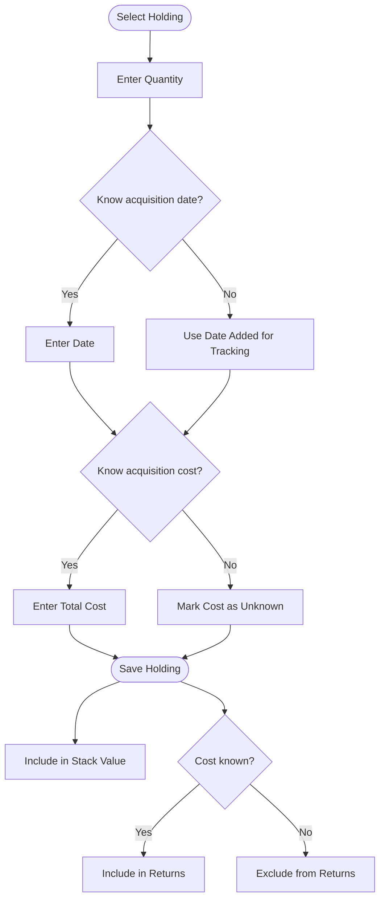
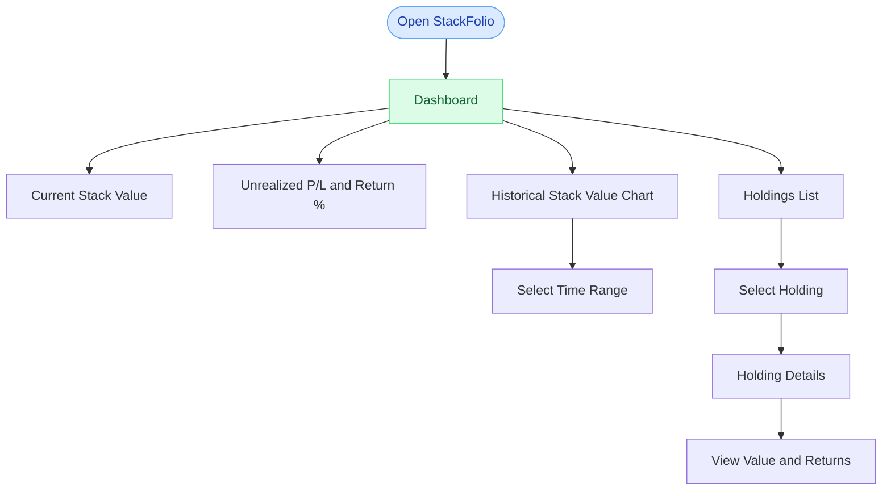

# StackFolio 2 MVP

## Core Product

**The question:** _What’s my stack worth today, and am I up or down?_

**Guiding principle:** _Open StackFolio. Know your stack. Know your gains._

**Product positioning:** Track your precious metals in one place. See their estimated liquidation value, what you’ve invested, and how much you’re up or down.

## Core Capabilities

| **Capability** | **Purpose**                                    |
| -------------- | ---------------------------------------------- |
| Add            | Record what I own and what I paid              |
| Value          | See what my stack is worth today and over time |
| Returns        | See how much I’ve gained or lost               |

## MVP Scope

**Included**

- Common gold and silver bullion from a predefined catalog
- Manually entered gold and silver jewelry
- Live precious-metal prices
- Estimated liquidation values
- Current and historical portfolio values
- Current and historical unrealized returns
- Optional acquisition date and cost

**Excluded**

- Selling and partial-sale workflows
- Rare and collectible coin valuations
- Jewelry brand, craftsmanship, and gemstone valuations
- User-defined jewelry premiums
- Historical reconstruction before holdings were added
- Platinum and copper support

## Data Model

Each holding captures:

| **Field**              | **Requirement**      |
| ---------------------- | -------------------- |
| Metal                  | Required             |
| Holding type           | Required             |
| Catalog product        | Required for bullion |
| Weight                 | Required             |
| Purity                 | Required             |
| Quantity               | Required             |
| Acquisition date       | Optional             |
| Total acquisition cost | Optional             |

For bullion, the catalog can automatically supply standard weight and purity.

For jewelry, users enter the precious-metal weight themselves, excluding gemstones and other materials.

**Still undecided:** whether identical items are stored individually or grouped behind the scenes.

## Valuation Rules

**Stack Value = Estimated Liquidation Value**

| **Holding type** | **Valuation method**                                    |
| ---------------- | ------------------------------------------------------- |
| Bullion          | Published dealer buyback prices                         |
| Jewelry          | Estimated scrap-metal payout based on weight and purity |

Valuations are estimates, not guaranteed selling prices.

Unknown cost doesn’t prevent a holding from contributing to Stack Value.

## Historical Tracking and Returns

| **Metric**             | **Needs acquisition cost?** |
| ---------------------- | --------------------------- |
| Current Stack Value    | No                          |
| Historical Stack Value | No                          |
| Current Returns        | Yes                         |
| Historical Returns     | Yes                         |

**Rules:**

- Unknown acquisition date --> Start history when added to StackFolio
- Unknown acquisition cost --> Exclude holding from returns, not Stack Value.
- Known cost, unknown date --> Current returns can still be calculated.
- Partially known costs --> Clearly label returns as partial.
- Historical portfolio charts reflect both changes in metal prices and changes in holdings.

## User Experience

**Add Flow:** Select product --> Enter quantity --> Optional acquisition details --> Save.

**View Flow:** Open app --> See Stack Value and returns --> Explore history or individual holdings.

## Decisions Still Open

**Holding organization:** Whether to store identical items as individual records or grouped quantities.

**Valuation data:** Which buyback data sources to use, and what happens when reliable prices aren’t available.

**Historical storage:** How to store valuation snapshots and preserve accurate history when holdings are edited or removed.
